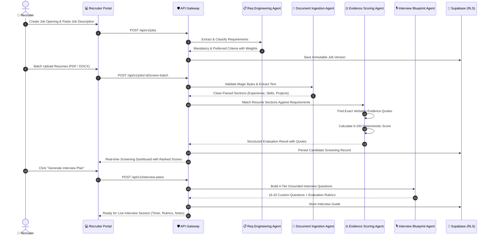
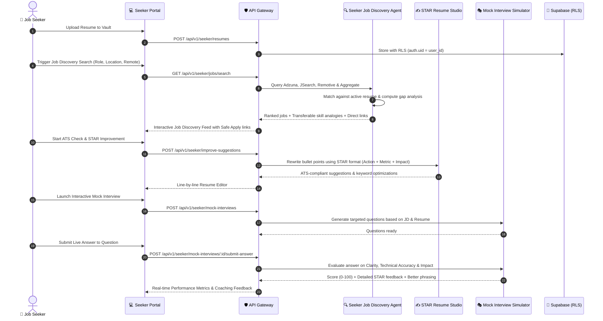

<div align="center">

# ⚡ TalentrivoX AI
### Enterprise Two-Sided Career Intelligence & Autonomous AI Recruitment Platform

[](https://www.typescriptlang.org/)
[](https://reactjs.org/)
[](https://vitejs.dev/)
[](https://nodejs.org/)
[](https://expressjs.com/)
[](https://supabase.com/)
[](https://ai.google.dev/)
[](https://vitest.dev/)
[](#-security-data-isolation--responsible-ai)

<p align="center">
  <b>TalentrivoX AI</b> is an enterprise-grade, specification-driven recruitment and career intelligence platform. Powered by an autonomous multi-agent pipeline and deterministic evidence-scoring engine, it unifies <b>Hiring Teams & Recruiters</b> with <b>Job Seekers & Candidates</b> in a high-trust, hallucination-free ecosystem.
</p>

[✨ Key Capabilities](#-key-capabilities) •
[🏛️ System Architecture](#-end-to-end-system-architecture) •
[🤖 Multi-Agent Orchestration](#-autonomous-multi-agent-orchestration-flows) •
[👥 Two-Sided Workspaces](#-two-dedicated-intelligent-workspaces) •
[🔍 Discovery Engine](#-agentic-job--candidate-discovery-ecosystem) •
[🔒 Security & Responsible AI](#-security-data-isolation--responsible-ai) •
[🚀 Quickstart Guide](#-quickstart--developer-guide)

---

</div>

## 🌟 Executive Overview

Traditional hiring tools rely on black-box keyword matching that produces hallucinations, fabricated candidate summaries, and untraceable bias. **TalentrivoX AI** re-engineers modern recruitment around **Deterministic Evidence Grounding** and **Autonomous Agentic Workflows**:

1. **Recruiter Intelligence:** Automates job requirement extraction, performs batch resume parsing with cryptographic magic-byte validation, and evaluates candidates strictly on verbatim text evidence (0–100 score). Generates 4-tier structured interview rubrics and provides live interview workspaces.
2. **Candidate Career Intelligence:** Empowers job seekers with a multi-version Resume Vault, automated ATS readability auditing, STAR-method line-by-line bullet rewrites, real-time interactive AI mock interview simulations, and multi-source global job discovery with 1-click tailored application tracking.
3. **Zero-Hallucination Policy:** Every match score, skill assessment, and interview question is backed by immutable quotes from source documents. If evidence does not exist in the resume, the system explicitly labels it as missing rather than assuming competence.

---

## 🏛️ End-to-End System Architecture

The following diagram details the complete frontend, API gateway, multi-agent reasoning layer, and data persistence topology:

```mermaid
flowchart TB
    subgraph CLIENT_LAYER["🖥️ Client Presentation Layer (React 18 + Vite + Tailwind/Modern CSS)"]
        Landing["🌐 Public Marketing & Responsible AI Charter (/)"]
        AuthPortal["🔐 Role-Aware Authentication (/login, /signup)"]
        RecruiterUI["💼 Recruiter Workspace (/app/*)\n• Pipeline Management\n• Batch Resume Screener\n• Evidence Profiles & Quotes\n• Candidate Comparison Matrix\n• Live Interview Workspace"]
        SeekerUI["🎯 Job Seeker Workspace (/app/seeker/*)\n• Career Command Center\n• Agentic Job Discovery (Adzuna/JSearch)\n• Resume Vault & STAR Studio\n• ATS Readability Checker\n• Live Mock Interview Simulator\n• Career Skill Roadmap"]
    end

    subgraph GATEWAY_LAYER["🛡️ Security Gateway & API Middleware (Express on Node.js)"]
        CORS["CORS & Origin Firewall"]
        RateLimit["Adaptive Rate Limiting"]
        JWTGuard["Role-Based Access Control (RBAC Guard)"]
        MagicValidator["Magic-Byte File Type Validator (PDF/DOCX)"]
        Sanitizer["XSS & Formula Injection Sanitizer"]
    end

    subgraph AGENT_ORCHESTRATION["🤖 Autonomous Multi-Agent Core Engine"]
        AgentParser["📄 1. Document Ingestion Agent\n• Magic-byte verification\n• PDF/DOCX structure parsing\n• PII scrubbing & text normalization"]
        AgentRequirements["📋 2. Requirement Engineering Agent\n• Semantic JD decomposition\n• Mandatory vs. Preferred classification\n• Immutable version hashing"]
        AgentScorer["⚖️ 3. Evidence Grounding & Scoring Agent\n• Verbatim quote extraction\n• Deterministic 0-100 score algorithm\n• Hallucination penalty engine"]
        AgentCandidateSource["🕵️ 4. Candidate Discovery Agent\n• GitHub Public Talent sourcing\n• Multi-criteria skill matching\n• Opt-in profile verification"]
        AgentInterview["🎙️ 5. 4-Tier Interview Blueprint Agent\n• Project verification (30%)\n• JD technical mastery (25%)\n• Core fundamentals (20%)\n• HR & behavioral (25%)"]
        AgentSeekerDiscovery["🔍 6. Seeker Job Discovery Agent\n• Multi-source aggregation (Adzuna, JSearch, Remotive)\n• Transferable skill analogies\n• Safe HTTPS URL validation"]
        AgentMockSimulator["🎭 7. Adaptive Mock Interview Agent\n• Real-time conversational simulator\n• Live rubric scoring\n• Instant STAR-method feedback"]
    end

    subgraph LLM_HYBRID_LAYER["🧠 Hybrid Intelligence & Fallback Layer"]
        GeminiAPI["Google Gemini 3.8 Flash (Active LLM)"]
        DeterministicEngine["Deterministic Rule & Pattern Engine (Offline Fallback)"]
    end

    subgraph DATA_PERSISTENCE["💾 Data & Storage Persistence Layer"]
        SupabaseDB[("Supabase PostgreSQL\n• Row-Level Security (RLS)\n• Multi-Tenant Isolation\n• Migration Schemas 00001-00003")]
        SupabaseStorage["🔒 Supabase Private Storage (Encrypted Resume Buckets)"]
        LocalDB[("Embedded Fast JSON Database (Local Fallback Mode)")]
    end

    CLIENT_LAYER --> GATEWAY_LAYER
    GATEWAY_LAYER --> AGENT_ORCHESTRATION
    AGENT_ORCHESTRATION <--> LLM_HYBRID_LAYER
    AGENT_ORCHESTRATION --> DATA_PERSISTENCE
```



---

## 🤖 Autonomous Multi-Agent Orchestration Flows

TalentrivoX AI operates through 7 specialized, cooperative AI agents designed for reliability, explainability, and speed.

### 1. Recruiter Sourcing, Screening & Interview Workflow



---

### 2. Job Seeker Career Intelligence & Interactive Mock Interview Flow



---

## 👥 Two Dedicated Intelligent Workspaces

| Area | 👔 Recruiter Workspace (`/app/*`) | 🎯 Job Seeker Workspace (`/app/seeker/*`) |
| :--- | :--- | :--- |
| **Primary Goal** | Streamline high-volume hiring with zero false positives | Accelerate career placement with tailored intelligence |
| **Core View** | Pipeline Kanban, candidate tables, and batch scorecards | Career intelligence dashboard, metrics & target roadmaps |
| **Document Handling** | Batch candidate ingestion, PDF/DOCX magic-byte validator | Personal Resume Vault with active version toggling |
| **AI Matching** | Deterministic 0–100 score strictly from verbatim quotes | Match analysis, gap breakdown & transferable skill analogies |
| **Content Studio** | Side-by-side multi-candidate comparison matrix | STAR-method bullet rewriter & ATS format auditor |
| **Interview Module** | 4-tier interview builder & live rating workspace | Interactive conversational mock simulator with instant scoring |
| **Discovery** | Autonomous candidate sourcing via GitHub Public Talent | Multi-source global job search (Adzuna, JSearch, Remotive) |
| **Tracking** | Stage management (Screening, Interview, Offer, Rejected) | 10-stage application lifecycle tracker with notes |

---

## 🎙️ 4-Tier Structured Interview Blueprint

Every interview plan generated by TalentrivoX AI strictly follows an enterprise-standard distribution to ensure comprehensive, fair evaluation:

```
┌─────────────────────────────────────────────────────────────────────────┐
│                    TALENTRIVOX AI 4-TIER INTERVIEW BLUEPRINT            │
├────────────────────────────────┬────────────────────────────────────────┤
│ 1. Project Verification (~30%) │ Deep-dive into candidate's projects    │
│    5-6 Questions               │ Architecture, trade-offs, schemas      │
├────────────────────────────────┼────────────────────────────────────────┤
│ 2. Job-Specific Tech (~25%)    │ Specific competencies in job description│
│    4-5 Questions               │ Framework internals, security, tooling │
├────────────────────────────────┼────────────────────────────────────────┤
│ 3. Core Fundamentals (~20%)    │ Foundational domain principles         │
│    3-4 Questions               │ OOP/FP patterns, concurrency, indexing │
├────────────────────────────────┼────────────────────────────────────────┤
│ 4. HR & Behavioral (~25%)      │ Communication, conflict resolution,    │
│    4-5 Questions               │ stakeholder management & ownership     │
└────────────────────────────────┴────────────────────────────────────────┘
```

---

## 🔍 Agentic Job & Candidate Discovery Ecosystem

### 1. Multi-Source Job Discovery for Candidates
* **Live Aggregation Providers:** Adzuna API, RapidAPI JSearch, Remotive Global, and Arbeitnow Network.
* **Direct Platform Deep Links:** Generates pre-filled search URLs for **LinkedIn Jobs**, **Indeed**, **Naukri**, **Foundit (Monster)**, and **Google Jobs**.
* **Safe External Redirection:** `SafeUrlValidator` enforces strict HTTPS protocol whitelisting, preventing open redirect vulnerabilities, XSS payloads, and malformed URLs.

### 2. Autonomous Candidate Sourcing for Recruiters
* **GitHub Public Talent Search:** Scans verified developer profiles, matching repository tech stacks, commit patterns, and public contact signals.
* **Smart Deduplication:** Canonical URL hashing ensures candidates are never duplicated across searches.
* **Opt-In Signal Verification:** Highlights candidates with verifiable open-to-work flags.

---

## 🔒 Security, Data Isolation & Responsible AI

### 🛡️ Security Architecture
* **Role-Based Access Control (RBAC):** Strict middleware guarantees Job Seekers cannot inspect Recruiter batch screenings, private interview ratings, or company pipelines.
* **Multi-Tenant Row-Level Security (RLS):** Supabase PostgreSQL schemas enforce `auth.uid() = user_id` on all personal data tables.
* **Private Storage Streams:** Uploaded resumes are stored in private buckets and served exclusively through authenticated API streams.
* **File Validation:** Magic-byte inspection guarantees uploaded files are genuine PDFs or DOCX binaries, blocking malicious file extensions.
* **CSV Injection Protection:** Sanitizes all dynamic fields against formula injection attacks (`=`, `+`, `-`, `@`).

### ⚖️ Responsible AI Charter
* **100% Traceable Evidence:** Every score requires a direct quotation from the candidate's resume.
* **No Unsubstantiated Penalties:** If a requirement is not mentioned in the resume, the system classifies it as *"Not Evidenced"* rather than guessing.
* **Model Agnostic & Resilient:** Primary LLM runs on **Google Gemini 3.8 Flash** with automatic fallback to deterministic pattern-matching engines when offline.

---

## 💻 Complete Technology Stack

| Layer | Technologies | Purpose |
| :--- | :--- | :--- |
| **Frontend UI** | React 18, Vite 5, Tailwind CSS, Lucide Icons | High-performance SPA with editorial warm neutral & dark cyber aesthetic |
| **Backend API** | Node.js (v20+), Express, TypeScript 5.5, Zod | Type-safe RESTful API with Zod schema validation & async handlers |
| **Primary AI Engine** | Google Gemini 3.8 Flash, Gemini 3.7 Flash, Gemini 3.5 | Semantic requirement extraction, STAR rewrites, and mock scoring |
| **Fallback Engine** | Custom Deterministic Pattern & AST Normalizer | Zero-dependency offline engine ensuring 100% platform uptime |
| **Database & Auth** | Supabase (PostgreSQL 15), Row-Level Security (RLS) | Cloud relational database with fine-grained multi-tenant isolation |
| **Local Database** | LowDB / Embedded JSON Engine | Instant out-of-the-box local development without cloud dependencies |
| **External Providers**| Adzuna, JSearch (RapidAPI), GitHub Search API | Real-world job aggregation and public candidate talent sourcing |
| **Testing Suite** | Vitest 2.1, Supertest | 83 unit, integration, seeker, and security tests with 100% pass rate |

---

## 🚀 Quickstart & Developer Guide

### Prerequisites
* **Node.js**: v18.0.0 or higher (v20+ recommended)
* **npm**: v9.0.0 or higher

### 1. Clone & Install Dependencies

```bash
# Clone the repository
git clone https://github.com/your-org/talentrivox-ai.git
cd talentrivox-ai

# Install all monorepo dependencies
npm install
```

### 2. Configure Environment Variables (`.env`)

Create a `.env` file in the root directory (or use the existing template):

```env
# Server Configuration
NODE_ENV=development
PORT=4000
APP_URL=http://localhost:5173
API_URL=http://localhost:4000

# Security
JWT_SECRET=avengercoders-secret-key-change-in-production-min32chars
MAX_UPLOAD_SIZE_MB=10
MAX_FILES_PER_BATCH=10

# Primary AI Provider (Gemini 3.8 Flash)
AI_PROVIDER=gemini
GEMINI_API_KEY=your_gemini_api_key_here
GEMINI_MODEL=gemini-3.8-flash
AI_REQUEST_TIMEOUT_MS=20000

# Supabase Configuration (Optional: uses embedded JSON storage if empty)
SUPABASE_URL=https://your-project.supabase.co
SUPABASE_ANON_KEY=your_supabase_anon_key
SUPABASE_SERVICE_ROLE_KEY=your_supabase_service_role_key
SUPABASE_STORAGE_BUCKET=resumes

# Real-World Job Discovery Providers (Optional)
ADZUNA_APP_ID=your_adzuna_app_id
ADZUNA_API_KEY=your_adzuna_api_key
ADZUNA_COUNTRY=us

RAPIDAPI_KEY=your_rapidapi_key
JSEARCH_API_HOST=jsearch.p.rapidapi.com

# Public Candidate Sourcing (Optional)
GITHUB_TOKEN=your_github_personal_access_token
```

### 3. Launch Development Environment

Run both the Backend API and Frontend Vite development servers concurrently:

```bash
npm run dev
```

* **Frontend Application:** [http://localhost:5173](http://localhost:5173)
* **Backend API Server:** [http://localhost:4000](http://localhost:4000)
* **API Health Check:** [http://localhost:4000/api/health](http://localhost:4000/api/health)

---

## 🧪 Comprehensive Test Suite

The platform includes **83 automated unit, integration, and security tests** across 10 test suites:

```bash
# Run all tests
npm test

# Run tests with interactive UI
npx vitest --ui

# Run TypeScript typechecks across all monorepo packages
npm run typecheck
```

### Test Coverage Highlights:
* `job_discovery.test.ts` — Multi-provider aggregation, geographic filtering, and safe URL validation.
* `candidate_discovery.unit.test.ts` — Sourcing ranking, keyword collision safeguards, and canonical deduplication.
* `seeker.test.ts` — Job seeker dashboard, Resume Vault, STAR rewriter, ATS quality checker, and mock interviews.
* `api.test.ts` — Recruiter job pipelines, batch resume ingestion, and candidate comparison matrices.
* `security.test.ts` — Magic-byte verification, CSV formula injection sanitization, and RBAC boundary enforcement.

---

## 📂 Monorepo Project Structure

```
talentrivox-ai/
├── apps/
│   ├── api/                          # Express Backend API Server
│   │   ├── src/
│   │   │   ├── ai/                   # Gemini 3.8 Flash & Deterministic AI Engine
│   │   │   ├── config/               # Environment & Database Configuration
│   │   │   ├── controllers/          # Recruiter & Seeker Route Controllers
│   │   │   ├── discovery/            # Candidate Sourcing & Job Aggregation Services
│   │   │   ├── matching/             # Evidence-Scoring Engine & Skill Normalizer
│   │   │   ├── middleware/           # RBAC, Rate Limiting, & File Validation
│   │   │   ├── parser/               # PDF & DOCX Document Extraction Engine
│   │   │   └── storage/              # Supabase & Local JSON Storage Adapters
│   │   └── test/                     # Vitest Integration & Unit Test Suites
│   │
│   └── web/                          # React 18 + Vite Frontend Application
│       ├── src/
│       │   ├── components/           # Reusable UI Design System & Cards
│       │   ├── context/              # Authentication & Global Workspace State
│       │   ├── pages/                # Recruiter, Seeker & Landing Page Views
│       │   └── services/             # API Client & External Platform Connectors
│
├── packages/
│   └── shared/                       # Shared TypeScript Interfaces, Types & Schemas
│
├── supabase/
│   ├── migrations/                   # PostgreSQL Schema & RLS Security Policies
│   └── seed.sql                      # Demo Seed Data (Jobs, Resumes, Applications)
│
├── sample_resumes/                   # Benchmark PDF/DOCX Resumes for Testing
├── .env                              # Environment Variable Configuration
└── README.md                         # Product Documentation & Architecture Guide
```

---

<div align="center">
  <sub>Built with precision and care for the future of ethical, intelligent hiring.</sub><br>
  <b>TalentrivoX AI © 2026. All rights reserved.</b>
</div>
